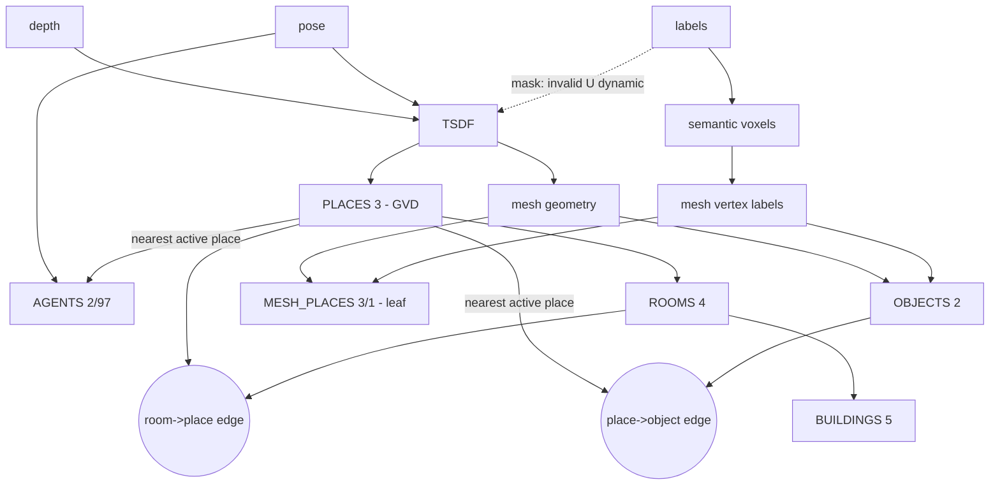

# Hydra scene-graph layers: real dependency DAG and parameter knobs (uHumans2 office config)

Author: sub-agent `dag_knobs`, 2026-11-01. Machine-readable twin: `findings.json` (same directory).

**Evidence conventions.** `src/...`, `include/...`, `python/...`, `config/...` are paths under `D:/Hydra`; every file cited here is identical
(ignoring CRLF) to the source of the WSL build in `~/hydra_ws/src/hydra` (compared file by file), and `config/datasets/uhumans2.yaml` plus
the label space are identical too. `[spark_dsg]` = `~/hydra_ws/src/spark_dsg`, `[config_utilities]` = `~/hydra_ws/src/config_utilities/config_utilities`.
`[clean log]` = the effective-config echo at the top of `~/runs/uh2/uh2_clean/logs/hydra_python.*.INFO.*` (line numbers of that file).
**V** = verified (code line and/or a command whose output I saw), **I** = inferred. Only development data was read (uh2_clean, seed-0 runs,
clean-data truncated runs); no per-run result of seeds 1/2 was opened.

## 0. Answers in one page

1. **Layers.** OBJECTS 2, AGENTS 2 (partition = robot prefix char 'a' = 97, saved key `2[97]`), PLACES 3 (partition 0, GVD free-space places, ids `p*`),
   MESH_PLACES 3[1] (partition 1 of the same layer id 3, 2D surface places, ids `P*`), ROOMS 4, BUILDINGS 5. So "3" and "3[1]" are **two
   partitions of one spark_dsg layer id**: separate node sets, separate intra-layer edges, no parent/child edges between them. The metric-semantic
   **mesh is not a node layer**; it is one `DynamicSceneGraph::mesh_` object. Frontier places would be PLACES nodes (`f*`) but `use_frontiers: false`.
2. **"mesh -> objects, mesh -> places, places -> rooms" is wrong in one edge and incomplete in four.**
   - WRONG: *mesh -> GVD places*. GVD places are computed from the **TSDF**, in a thread parallel to the mesh branch; they never read the mesh.
     Mesh and GVD places are siblings under a shared hidden parent (the TSDF). Test: a mesh-only parameter fault changes mesh, objects and
     MESH_PLACES while PLACES, ROOMS, BUILDINGS stay identical (section 6.3, run `kv_meshres`).
   - Only the 2D surface places depend on the mesh, and nothing depends on them (leaf).
   - INCOMPLETE 1: labels are not "detections"; they enter the semantic voxel layer and become a **label channel of the mesh**. Objects are
     clustered from labeled mesh vertices. Label faults corrupt this channel first (5.1 % of vertices relabeled, 0.0 m geometry change).
   - INCOMPLETE 2: objects reach rooms only via an **association edge** place -> object created in the frontend (nearest active place), so
     "object in room R" = `room(parent_place(object))`, a function of three layers (section 4.2).
   - INCOMPLETE 3: buildings = f(rooms); the saved graph has **no room -> building edge because of functor order** (section 4.3, causal test).
   - INCOMPLETE 4: depth and pose faults both go through the TSDF, so they enter mesh and places **in parallel** (pose_drift too, which
     `inject.py` currently lists as mesh only).
3. **Backend (our runs).** No loop closure ever happens (V: `loop_closures.csv` header only; 1818 backend steps all `total_lc=0`; no optimizer or
   mesh-deformation timer), so PGMO optimization, mesh deformation and node motion never occur. Backend effects on lower layers = duplicate-node
   **merging** (objects 145->109, places 1302->1068, 2D places 4163->2774) plus creation of rooms and building. No higher->lower feedback.
4. **Config keys.** 92 leaf keys in `config/datasets/uhumans2.yaml`: 89 applied, 3 silently ignored (`frontend.freespace_places.min_places_component_size`
   [real field is `min_component_size`, same value 3], `frontend.freespace_places.graph.type`, `backend.pgmo.embed_trajectory_delta_t`).
   Misspelled key: silently ignored. Wrong value type: warning, default kept. Wrong factory `type:`: `[ERROR]` log and the module is **absent**
   (run still finishes, layers missing; not a crash). Value violating a `check()`: `RuntimeError` at start-up, no output.

## 1. Layer inventory

| project layer | spark_dsg key / prefix | attrs class | produced by (Hydra component) | stage | consumes (inputs) |
|---|---|---|---|---|---|
| mesh (not a node layer) | `mesh_` of the graph; vertices carry pos, color, **label**, first-seen stamp | spark_dsg `Mesh` | `ReconstructionModule` (TSDF -> `MeshIntegrator`, marching cubes) then `GraphBuilder::updateMesh` (`kimera_pgmo::DeltaCompression`, `frontend.pgmo.mesh_resolution`) | active window + frontend | TSDF distance/weight, semantic voxel label, color |
| OBJECTS | `2`, `O*` | `ObjectNodeAttributes` (`mesh_connections` = vertex indices) | `MeshSegmenter` via `GraphBuilder::updateObjects` (post-mesh callback) | frontend, merged in backend | mesh-delta vertices whose label is in `object_labels`; vertex positions |
| AGENTS | `2[97]`, `a*` | `AgentNodeAttributes` | `PoseGraphFromOdom` via `GraphBuilder::updatePoseGraph` | frontend | pose only |
| PLACES (GVD) | `3` (partition 0), `p*` | `PlaceNodeAttributes` (pos, radius `distance`) | `GvdPlaceExtractor` (`GvdIntegrator` + `GraphExtractor`) via `GraphBuilder::updatePlaces` | frontend, merged in backend | **TSDF layer only** (downsampled x2); pose only for the archive window |
| MESH_PLACES | `3[1]` (partition 1), `P*` | `Place2dNodeAttributes` | `Place2dSegmenter` via `GraphBuilder::updatePlaces2d` (post-mesh callback) | frontend, merged in backend | mesh-delta vertices with label in `surface_places_labels` {3 floor, 15 stairs} |
| ROOMS | `4`, `R*` | `RoomNodeAttributes` | `UpdateRoomsFunctor` -> `RoomFinder` | backend (every step) | PLACES layer, category `p` nodes only: radius, position, `last_update_time_ns`, place-place edge weights |
| BUILDINGS | `5`, `B0` | `SemanticNodeAttributes` | `UpdateBuildingsFunctor` | backend | ROOMS positions (centroid) |
| frontiers (off) | `3` (PLACES), `f*`, `real_place=false` | `PlaceNodeAttributes` | `FrontierExtractor` | disabled | TSDF frontier voxels |

Evidence (V): layer ids [spark_dsg] `src/scene_graph_types.cpp:74-92` (SEGMENTS 1 unused, OBJECTS 2, AGENTS 2, PLACES 3, MESH_PLACES {3,1}, ROOMS 4,
BUILDINGS 5); Hydra's own map `include/hydra/common/shared_dsg_info.h:47-56` and `[clean log]` lines 41-47; "greater id is ancestor, partitions
own disjoint node sets" [spark_dsg] `include/spark_dsg/dynamic_scene_graph.h:56-77`; mesh is a member, not a layer `:534`; agent partition =
robot prefix `src/odometry/pose_graph_tracker.cpp:67-73`; id prefixes `src/frontend/mesh_segmenter.cpp:98` (O), `src/places/graph_extractor.cpp:197` (p),
`config/datasets/uhumans2.yaml:24` (P), `include/hydra/rooms/room_finder_config.h:50` and `src/rooms/room_finder.cpp:319` (R),
`src/backend/update_buildings_functor.cpp:55` (B0); frontiers `src/frontend/frontier_extractor.cpp:523-550`, disabled `src/frontend/graph_builder.cpp:128-130`.
Saved clean graph (`research/dag_knobs/inspect_clean_backend.txt`): layer keys 2, 2[97], 3, 3[1], 4, 5; 109 / 628 / 1068 / 2774 / 8 / 1 nodes.

## 2. The DAG

Per frame the pipeline is synchronous (`python/bindings/src/python_pipeline.cpp:230-243`: `active_window_->step` -> `frontend_->spinOnce` ->
`backend_->step(false)`); only frames with `>= full_update_separation_s` (0.2 s) since the last full update reach the frontend
(`src/active_window/reconstruction_module.cpp:113-120,168`). Inside the frontend, `launchCallbacks` starts **one thread per callback and joins**
(`include/hydra/common/launch_callbacks.h:42-52`), which is why mesh branch and GVD branch are independent by construction.

```
 frame i:  depth_i      pose_i (world_T_body)      labels_i (int32 ids)        color_i
              |            |      \                    |                          |
              |            |       \ (odometry)        |                          |
              v            v        v                  v                          v
        +-------------------------------------------------------------------------------+
        | ReconstructionModule                                                          |
        |  TSDF (distance, weight) <- depth range image + sensor pose                   |
        |       voxels whose pixel label is in invalid U dynamic={20} are skipped       |
        |  semantic voxels <- labels, SingleLabelIntegrator vote (inside truncation)    |
        |  block mesh <- marching cubes on TSDF (weight >= mesh.min_weight);            |
        |       vertex label = label of semantic voxel at the cube corner               |
        +-------------------------------------------------------------------------------+
            |  ActiveWindowOutput.map (updated blocks)                    |
   +--------+-----------------------+                                     |
   | mesh branch (frontend thread)  |                    GVD branch (thread, TSDF only)
   v                                |                                     v
 DeltaCompression(mesh_resolution)  |                    TSDF --downsample x2--> GvdIntegrator -> GraphExtractor
   |                                |                    (compression, min_node_dist, min_edge_dist, merge)
   v                                |                         -> filterIsolated(min_component_size)
 DSG MESH (pos, label, color)       |                                     |
   |-- label in object_labels --> MeshSegmenter (Euclid. clustering) --> OBJECTS  (2)       PLACES (3)
   |-- label in {3,15} ---------> Place2dSegmenter --------------------> MESH_PLACES (3[1])   |
   |                                       (leaf: nothing reads it)                           |
   |                                                                                          |
   +--------------------- frontend GraphConnector: nearest ACTIVE place (3D) is the parent ---+
                              PLACES --parent--> OBJECTS      PLACES --parent--> AGENTS(2[97])
 ====================================== frontend graph (saved as frontend/dsg*.json) =========
 backend step, functors in ALPHABETICAL key order (std::map): agents, buildings, frontiers,
   objects, places, rooms, surface_places, zmq_labels
   objects/places/surface_places : merge duplicate nodes (enable_node_merging), rewire parent edges
   rooms     : RoomFinder(PLACES 'p' nodes only) -> delete ALL rooms, re-create ROOMS (4) and
               ROOMS --parent--> PLACES edges, every step
   buildings : B0 at centroid of the rooms of the PREVIOUS step; edges B0 -> rooms are wiped by 'rooms'
   no loop closure in our runs => no PGMO optimization, no mesh deformation, nothing moves
 query "object o in room R":   R --parent--> place p --parent--> o       (two association hops)
```



Edge list with evidence (V):

| from -> to | passes | evidence |
|---|---|---|
| depth -> TSDF | range image `|p_C|` per pixel, ray density weight, sdf = range - voxel distance, truncated | `src/input/camera.cpp:113-115,226-260`; `src/reconstruction/projective_integrator.cpp:207-258,323-382` |
| pose -> TSDF | sensor pose = `world_T_body * body_T_sensor` projects every voxel into the image | `include/hydra/input/input_data.h:68-70`; `projective_integrator.cpp:173-205` |
| labels -> TSDF (mask only) | pixels with label in `invalid_labels` U `dynamic_labels` ({20}) make the voxel **not integrated at all** | `src/active_window/reconstruction_module.cpp:149-157,161`; `src/reconstruction/integration_masking.cpp:75-99`; `projective_integrator.cpp:394-398`; `[clean log]` 52-53 |
| labels -> semantic voxels | label per voxel from interpolated label image, vote with weight, only inside the truncation band | `projective_integrator.cpp:290-305,384-407`; `src/reconstruction/semantic_integrator.cpp:187-210` |
| TSDF -> mesh geometry | marching cubes at the zero crossing of voxels with weight >= `mesh.min_weight` | `src/reconstruction/mesh_integrator.cpp:229-250,295-350`; `src/reconstruction/mesh_integrator_config.cpp:42-49` |
| semantic voxels -> mesh labels | vertex label = voxel label (`interpLabel` on edges); missing -> uint32 max | `mesh_integrator.cpp:244-247,349-350`; `src/reconstruction/marching_cubes.cpp:63-69,113,128,245-248` |
| mesh -> DSG mesh | block mesh -> `DeltaCompression(mesh_resolution)` -> `MeshDelta::updateMesh` | `src/frontend/graph_builder.cpp:404-435` |
| DSG mesh labels+pos -> OBJECTS | active-delta vertices with label in `object_labels`, Euclidean clustering, node = cluster | `graph_builder.cpp:437-453`; `src/frontend/mesh_segmenter.cpp:107-162,298-320`; `src/frontend/mesh_delta_clustering.cpp:40-113` |
| DSG mesh labels+pos -> MESH_PLACES | vertices with label in `surface_places_labels`, clustering + recursive split | `graph_builder.cpp:544-560`; `src/frontend/place_2d_segmenter.cpp:135-179,334` |
| TSDF -> PLACES | `msg.map().getTsdfLayer()` (optionally downsampled) -> GVD -> compressed place graph | `src/frontend/gvd_place_extractor.cpp:116-163,198-250`; `graph_builder.cpp:502-542` |
| pose -> AGENTS | one agent node per sufficiently separated pose + odometry edge | `src/odometry/pose_graph_from_odom.cpp:95-130`; `src/odometry/pose_graph_tracker.cpp:44-103` |
| PLACES, OBJECTS -> place->object edge | parent = nearest active place by 3D node position (KD-tree, L2) | `src/frontend/graph_connector.cpp:114-182`; `src/utils/nearest_neighbor_utilities.cpp:47-75`; called at `graph_builder.cpp:383` |
| PLACES, AGENTS -> place->agent edge | same rule (child layer = layer id 2, `include_partitions: true`) | `graph_connector.cpp:114-182`; `[clean log]` 215-222 |
| PLACES -> ROOMS | graph filtration over place radii/edge weights, component threshold, region growing | `src/backend/update_rooms_functor.cpp:85-107`; `src/rooms/room_finder.cpp:156-310`; `src/rooms/graph_filtration.cpp:139-321,501-571`; `src/rooms/graph_clustering.cpp:195-253` |
| ROOMS -> place->room edge | `insertEdge(room, place, nullptr, true)` for every clustered place | `room_finder.cpp:340-355` |
| ROOMS -> BUILDINGS | centroid of room positions; edges B0 -> rooms | `src/backend/update_buildings_functor.cpp:52-85` |
| frontend graph -> backend graph | `mergeGraph` every frontend step, then update functors | `graph_builder.cpp:341-346`; `src/backend/backend_module.cpp:435-451`; `src/backend/dsg_updater.cpp:100-152` |

## 3. What each layer consumes (details and the places/surface-places question)

**3.1 TSDF, semantic voxels, mesh.** The only consumers of raw depth/pose/labels are `ReconstructionModule` (TSDF, semantic layer, block mesh) and
`PoseGraphFromOdom` (pose). Geometry of the mesh depends on depth and pose only; **label values never change vertex positions** unless the label is
in the mask set (then the voxel is skipped, `projective_integrator.cpp:394-398`). V empirically: label_confusion and label_dropout (seed 0, severity
0.5) change 5.11 % / 5.12 % of the 448,062 mesh vertex labels with `max |dx| = 0.0 m` and identical vertex count
(`research/dag_knobs/verify_claims_out.json`).

**3.2 Objects consume labeled mesh vertices, not detections.** `MeshSegmenter::detect` takes the mesh *delta* (vertices of the active window),
keeps vertices whose `traits.label` is in `object_labels` (`mesh_delta_clustering.cpp:40-72`, labels from the label space `[5,6,7,10,12,13,18]`,
`[clean log]` 54, 86), skips labels with fewer than `min_cluster_size` vertices (`mesh_segmenter.cpp:125-128`), runs PCL Euclidean clustering
(`mesh_delta_clustering.cpp:91-96`) and creates one node per cluster with `semantic_label = label` and `mesh_connections` = vertex indices
(`mesh_segmenter.cpp:298-320`). Position/bbox are recomputed from the referenced mesh vertices (centroid, AABB; `src/utils/mesh_utilities.cpp:49-89`),
also in the backend from the backend mesh (`src/backend/update_objects_functor.cpp:105-149`). Nodes with fewer than `min_cluster_size` connections
are deleted (`mesh_segmenter.cpp:179-183`). In the saved clean graph 99.12 % of object-referenced vertices carry the object's label and every object
has >= 89.9 % (`inspect_clean_mesh_links.txt`). No external detector feeds objects: `ActiveWindowOutput::graph_update` is never filled by
`ReconstructionModule` (`reconstruction_module.cpp:178-189`). **Where labels enter:** `active_window.tsdf.semantic_integrator.type: SingleLabelIntegrator`
(`config/datasets/uhumans2.yaml:11-13`) -> `ProjectiveIntegrator` (`projective_integrator.cpp:101-102,302-305`); one label + weight per voxel, a
mismatching observation first cancels weight before it can flip the label (`semantic_integrator.cpp:187-210`).
Direct proof from an earlier truncated run (`apply_test_compare.json`, `tmp_dk_typeb`, semantic integrator type misspelled so none is created):
OBJECTS and MESH_PLACES are **absent**, PLACES (20 nodes, identical ids and positions), ROOMS and BUILDINGS are present.

**3.3 PLACES (GVD) consume the TSDF only.** `GvdPlaceExtractor::detect(msg)` reads `msg.map().getTsdfLayer()` (`gvd_place_extractor.cpp:119,128-134`),
optionally downsampled by `tsdf_interpolator` (ratio 2 here, so the GVD runs on a 0.2 m grid), then `updateFromTsdf`/`updateGvd` (`:147-148`); the robot
pose is used only for the archive window (`:150-159`) and `filterGround` (off). Neither the DSG mesh nor labels are read anywhere on this path, and the
callback runs in its own thread next to the mesh branch (`graph_builder.cpp:141-148`). `voxblox_mesh_connections` of a place are GVD basis-point voxel positions
from the GVD parent tracker, not mesh indices (`src/places/graph_extractor.cpp:218-249`). **Empirical proof:** `frontend.pgmo.mesh_resolution` 0.005 -> 0.1
changes mesh vertices, object centroids and MESH_PLACES, while PLACES (86 nodes), ROOMS and BUILDINGS stay identical (max |dpos| = 0), section 6.3.

**3.4 Surface (2D) places consume the mesh.** `Place2dSegmenter::detect` takes the mesh delta, selects vertices with labels in
`surface_places_labels` (`place_2d_segmenter.cpp:143,334`; label space `[3,15]`), clusters them (`cluster_tolerance`, `min_cluster_size`), recursively splits
(`pure_final_place_size`, `min_final_place_points`: `src/frontend/place_2d_split_logic.cpp:175-228`) and connects overlapping ellipses
(`place_overlap_threshold`, `place_max_neighbor_z_diff`: `:230-249`). The nodes live in partition 1 (`MESH_PLACES`), have **no parent edges** (V: histogram in
`inspect_clean_backend.txt`: all 2774 have 0 parents, no `3[1]` edge in `parent_child_edge_counts`) and nothing reads them (rooms read `PLACES` only,
`update_rooms_functor.cpp:92-99`). They are a dead end for the query.

**3.5 Rooms consume only the places layer.** `UpdateRoomsFunctor::call` clones the backend PLACES layer keeping category-`p` nodes
(`update_rooms_functor.cpp:98-99`), `RoomFinder::findRooms` builds a filtration from node radii (`PlaceNodeAttributes::distance`) and edge weights
(`graph_filtration.cpp:139-160`), picks a dilation threshold inside `[min_dilation_m, max_dilation_m]` (`room_finder.cpp:175-225`), takes components with
>= `min_component_size` places (`:249-263`), grows them over the remaining places (`clusterGraphByNeighbors`, `graph_clustering.cpp:195-253`) and keeps
clusters with >= `min_room_size` places (`room_finder.cpp:62-81`). Room position = centroid of member places projected into free space
(`src/rooms/room_utilities.cpp:39-79`). Room ids are ordered by the oldest `last_update_time_ns` of each cluster (`room_finder.cpp:62-81,315-334`) and
re-created from `R0` every step, so **room ids are not stable across runs**; match rooms by place membership or position. V: `research/config_faults`
re-implements this offline from the saved places layer and reproduces room count and threshold exactly (sizes within 3 places).

**3.6 Buildings** = centroid of the room positions (`update_buildings_functor.cpp:66-79`); no room -> the building node is removed (`:58-64`).
**3.7 Agents** = pose graph nodes; they depend on poses only (`pose_graph_from_odom.cpp:95-130`).

## 4. Edges and the query "object in room R"

### 4.1 Who creates which edge

| edge | created by | when / rule | in saved clean graph |
|---|---|---|---|
| place -> object (parent -> child) | **frontend** `GraphConnector` (`graph_connector.cpp:114-182`), not a backend functor | every frontend step: each active child is re-attached to the nearest active place, `insertEdge(parent, child, nullptr, true)` (single parent); frozen when the parent is archived | 113 edges; 105 objects have 1 parent, 4 have 2 (V: merging, see below) |
| place -> agent | same connector | same | 627 |
| room -> place | **backend** `UpdateRoomsFunctor` -> `RoomFinder::addRoomPlaceEdges` (`update_rooms_functor.cpp:105`, `room_finder.cpp:340-355`) | every backend step, after all rooms were deleted and re-created | 1068 (every place) |
| room -- room | `addEdgesToRoomLayer` (`room_utilities.cpp:81-116`) | rooms whose member places are adjacent | 8 edges |
| place -- place | `GraphExtractor` (`graph_extractor.cpp:981-1005`, overlap/freespace edges `:404-430`) | edges with clearance < `min_edge_distance_m` are dropped | 4128 |
| building -> room | `UpdateBuildingsFunctor` (`update_buildings_functor.cpp:81-84`) | inserted, then **erased by the rooms functor in the same step** (4.3) | **0** |

Why 4 objects have two parents: the backend merges objects with `graph.mergeNodes(from, to)`, which re-wires both parent and child edges of the absorbed node
onto the survivor without a single-parent check ([spark_dsg] `src/dynamic_scene_graph.cpp:520-550`; `src/backend/merge_tracker.cpp:41-98`). In the frontend graph every
one of the 145 objects has exactly one parent (`inspect_clean_frontend.txt`).

### 4.2 What the place -> object edge means for the query

`room_of(object) = room(parent_place(object))`. The parent is **not** geometric containment; it is the Euclidean-nearest active GVD place to the object centroid
at association time. V on the clean graph (`verify_claims_out.json`, 109 objects): parent is the currently nearest place for 82.6 %, within the 3 nearest for
92.7 % (worst rank 26); distance object -> parent place 0.31 / 0.78 / 2.82 m (min / median / max); only 7.3 % of objects lie inside their parent place's
free-space sphere (objects sit on surfaces, places sit in free space); `room(parent)` equals `room(nearest place)` for 95.4 %; the 4 two-parent objects are in one room.
Consequences for attribution:
- The query result depends on **three layers**: the object centroid (mesh + labels), the set and positions of places (TSDF/GVD), and the room partition of places.
  A correct object can fail the query because of a **places** fault (nearest place changes or the place is removed) or a **rooms** fault (place -> room edge
  changes, or `room_missing` when the place's cluster was dropped by `min_room_size`).
- Parent edges are computed from places and objects together, so a places fault changes the *edges* of objects while the object nodes stay identical
  (and a rooms fault changes the *edges* of places while the place nodes stay identical; config_faults confirms: `places.nodes` identical,
  `places.nodes_and_parent_edge` different). Layer-difference features must compare **node sets and association edges separately**; attribute the
  place -> object edge to PLACES (it is produced by place geometry) and the room -> place edge to ROOMS.
- The association is made in the frontend before backend merging; merging only re-wires (4.1). It is never recomputed from the final graph.

### 4.3 Why the saved graph has no room -> building edge (causal test)

`DsgUpdater` copies the `update_functors` config into a `std::map<std::string, ...>` (`include/hydra/backend/dsg_updater.h:93`, `src/backend/dsg_updater.cpp:69-72`),
so the functors run in **alphabetical key order**, not in YAML order (the config type is an `OrderedMap`, `dsg_updater.h:71-72`, but the order is lost).
Order: agents, **buildings**, frontiers, objects, places, **rooms**, surface_places, zmq_labels (matches `[clean log]` lines 409-418: objects, places,
room finder, surface places). `UpdateBuildingsFunctor` therefore sees the rooms of the *previous* step and inserts `B0 -> room` edges
(`update_buildings_functor.cpp:81-84`); then `UpdateRoomsFunctor::rewriteRooms` removes **every** room node, which deletes those edges, and re-creates the rooms
(`update_rooms_functor.cpp:59-83`). Building position is also one step stale.
V by experiment (60-step truncated runs, only difference = YAML key `buildings` renamed `zz_buildings`, same functor type; `order_test_result.json`):
base run: room has 0 parents, building has 0 children, building position differs from the room centroid by 0.197 m; renamed run: room has 1 parent, building has
1 child, difference 0.0 m. The clean full run: 8 rooms with 0 parents, building has 0 children, offset 8.3e-6 m.

## 5. Backend effects (do lower layers move? any feedback?)

- **No optimization in our runs (V).** `BackendModule::spinOnce` calls `optimize()` only if `(optimize_on_lc && have_loopclosures_) || force_optimize_`
  (`backend_module.cpp:261-267`); otherwise `updateDsgMesh` returns before deforming (`:472-476`) and the functors get `UpdateInfo{timestamp_ns}` with null
  `pgmo_values`/`deformation_graph`. `have_loopclosures_` needs a loop closure from the LCD queue, an external receiver or external priors
  (`:344-382,389-414`); the Python pipeline has no LCD module (`python_pipeline.cpp:184`, `enable_lcd: false`, `[clean log]` 7). Evidence: `backend/loop_closures.csv` = header only;
  `backend/pgmo/dsg_pgmo_status.csv`: 1818 rows, `total_lc = 0` and `new_lc = 0` in all; `timing_stats.csv` has no `dsg_updater/optimization` or `backend/mesh_deformation`;
  the frontend and backend meshes are identical (`inspect_clean_mesh_links.txt`: max |dv| 0.0, labels equal).
- **Hence these keys are inert here:** `backend.add_places_to_deformation_graph`, `backend.optimize_on_lc`, `backend.pgmo.*` (optimizer, covariance, interp), `frontend.pgmo.d_graph_resolution`,
  `frontend.pgmo.time_horizon`. The functors' own guards agree: `UpdateAgentsFunctor` returns without `pgmo_values` (`update_agents_functor.cpp:72-74`),
  `DeformationInterpolator::interpolateNodePositions` returns without a deformation graph (`deformation_interpolator.cpp:112-114`).
  {{INERT}}
- **If a loop closure existed (not our case, I):** agent poses move (`UpdateAgentsFunctor`), the mesh is deformed (`updateDsgMesh`), objects follow through `mesh_connections`
  (geometry is recomputed from the mesh, `update_objects_functor.cpp:140`), GVD places are interpolated from the deformation graph (`update_places_functor.cpp:143-146`), 2D places follow
  their mesh vertices (`update_surface_places_functor.cpp:180-200`).
- **What the backend does change (V):** merging (`enable_node_merging: true`; `dsg_updater.cpp:105-106,127-148`): OBJECTS 145 -> 109 (same label, bbox contains the other's centroid,
  `update_objects_functor.cpp:151-178`), PLACES 1302 -> 1068 (both real places within `pos_threshold_m` 0.4 m and radius difference <= `distance_tolerance_m` 0.4 m,
  `update_places_functor.cpp:152-187`), MESH_PLACES 4163 -> 2774 (frontend vs backend counts, `inspect_clean_frontend.txt` vs `inspect_clean_backend.txt`). It also creates ROOMS and BUILDINGS (absent from
  the frontend graph). Merge candidates only come from *inactive* (archived) nodes (`src/backend/association_strategies.cpp:112-181`), so pose faults that change the archive timing change merging.
- **No higher -> lower feedback (V by reading):** the rooms functor reads PLACES and writes ROOMS plus room -> place edges only; buildings read ROOMS; no functor writes to the mesh, the frontend graph or the
  TSDF; the frontend never reads the backend graph (`graph_builder.cpp:341-346` only writes to it). `zmq_labels` only sets room labels from a socket nobody serves.

## 6. Faults, entry layers, accept sets

### 6.1 Vocabulary

*Entry set* E(f) = layers whose own stored output is corrupted by the fault because the corrupted input is consumed by that layer's code. *Propagated* = descendants
in the DAG. Ground truth for scoring should be E(f), never the descendants. Because depth and pose go through the shared TSDF, E has **two members** for geometry faults; a top-1
rule with a single "first layer" is therefore ambiguous and an accept set is required.

### 6.2 Table (project layers: mesh, objects, places, rooms, buildings)

| fault | corrupted input | enters directly | propagates only to | recommended GT (strict) | accept set (lenient) |
|---|---|---|---|---|---|
| depth_noise, depth_holes | depth | **mesh and places in parallel** (both read the corrupted TSDF) | objects (via mesh labels/positions), MESH_PLACES, rooms and buildings (via places), place->object edges | `{mesh, places}` | `{mesh, places}` |
| pose_drift | pose | **mesh and places in parallel** (sensor pose projects voxels into the image; same TSDF), also AGENTS (outside the five), archive window | same as above | `{mesh, places}` | `{mesh, places}` |
| frame_drop | whole frames (depth, labels, color, pose) | mesh (geometry and label channel) and places (TSDF coverage), AGENTS, update timing | objects, rooms, buildings | `{mesh, places}` | `{mesh, places}` |
| label_confusion, label_dropout | labels | semantic voxels -> **mesh label channel** (geometry untouched); MESH_PLACES only by spill-over | objects (clustering input), place->object edges of changed objects | `{objects}` | `{objects, mesh}` |

Notes on the table:
- Label faults, V (`verify_claims_out.json`, seed 0, severity 0.5): mesh vertex positions identical (448,062 vertices, max diff 0.0 m); 5.1 % of vertex labels changed
  (confusion: 5->6 5687, 7->5 5229, 10->12 4026, 18->13 3288, 13->18 2234, 12->10 2131, plus small spill-over such as 13->19 69, 10->16 59, 5->3 54; dropout: the same vertices -> label 0);
  PLACES 1068/1068 and ROOMS 8/8 identical in id and position (max diff 0.0); OBJECTS 109 -> 169 (confusion) and 109 -> 66 (dropout); **MESH_PLACES 2774 -> 2760** because the floor-label vertex
  set grows by 73 (voxel votes for the object class are removed, the neighbouring floor/wall class wins). So label faults are *not* strictly confined to objects: they also touch the 2D-place leaf slightly.
- Dynamic label 20 caveat (I from code): any injected label equal to a dynamic or invalid label (here only 20 = human) would mask voxels out of the TSDF and change geometry; the current label
  injection uses object labels and void label 0, so it does not.
- pose_drift and frame_drop: only their TSDF path is certain; the project descriptive run reported frame_drop 25 % changing places and rooms but not mesh/objects within tolerance, which
  is compatible with GVD being the more sensitive consumer of a slightly different TSDF. A method that blames places for frame_drop is therefore right.

### 6.3 Recommendation, with the label-fault discussion

- **Score with an accept set, not a single layer, for geometry faults**: `{mesh, places}`. Report top-1 accuracy under the accept set and, separately, "which member was named".
- **Label faults.** The mesh label channel is physically the first corrupted artifact (semantic voxel -> mesh vertex label), objects are the first *node layer* that changes. Recommended:
  keep `objects` as GT (matches `expected_first_layer` in the injection manifests and the project's reading of labels as object evidence), define the **mesh discrepancy as geometry only**
  (vertex positions / faces), and put the label-channel statistics (fraction of vertices whose label differs, label histogram) into the **objects** node features.
  Then label faults leave mesh, places, rooms clean and flip only objects, which is also the sharpest diagnostic signature. Report the strict score ({objects}) as the headline and the lenient
  one ({objects, mesh}) as secondary, because a method that names "mesh" for a label fault is not wrong in the physical sense (the pipeline has no detection layer).
  Alternative if the team defines mesh = metric-**semantic** mesh (standard 3DSG layer 1): then GT for label faults becomes `{mesh}` with accept set `{mesh, objects}`; do not mix the two conventions.
- **Parameter faults:** GT = the layer that owns the key (section 7); accept set = that layer alone, except TSDF-level keys (voxel size, truncation, weights, interpolation, update rate, map-window radius)
  which enter `{mesh, places}` like depth faults. Rooms faults leave place *nodes* identical but change place -> room edges (do not score "places"); places faults leave object nodes identical but change
  place -> object edges (do not score "objects").
- **Fix to `inject.py` metadata** (not edited by me): `FAULT_META["pose_drift"]` lists no direct second layer; by the TSDF argument it should be `("mesh", ["places"], ...)` like the depth faults, and
  `FAULT_META["frame_drop"]` has `"all"`, which is not a layer; use `("mesh", ["places"], ...)`.

### 6.4 Where the simplification is wrong or incomplete (honest list)

1. mesh -> places is **false** for GVD places (TSDF is the common parent; V by code and by `kv_meshres`). It is true only for MESH_PLACES, a leaf nobody reads.
2. Labels do not exist as an object-layer input; they are a channel of the mesh (and an optional mask of the TSDF).
3. places -> rooms is right but incomplete: rooms use only category-`p` GVD places, edge weights and radii, never MESH_PLACES, objects or the mesh. Rooms are re-created every step and ids are unstable.
4. "objects in rooms" is not in the DAG as a data edge: it is an association made from object centroids and place positions; objects never feed places or rooms.
5. buildings are f(rooms) with a one-step lag, and their edges to rooms are absent because of functor order (section 4.3).
6. The pose enters at three points, not one: TSDF integration, AGENTS, and the archive window that decides which blocks/nodes are active and when they may be merged.

## 7. Config knobs

### 7.1 How the config is loaded, parsed and verified

- `hydra_python.pipeline.load_configs` reads `config/datasets/<dataset>.yaml` and `config/label_spaces/<labelspace>_label_space.yaml` only (`python/src/hydra_python/pipeline.py:95-115`), merges them
  (label-space keys at the root) and then **overwrites** `frontend.type`, `frontend.objects.bounding_box_type` (always `"AABB"`), `backend.type`, `reconstruction.*`, `lcd.*` (`:117-130`).
  So `frontend.objects.bounding_box_type` in the dataset yaml is **overridden** and cannot be a knob, and `reconstruction.*`/`lcd.*` are not read by `PythonPipeline::Config`, whose only roots
  are `active_window`, `frontend`, `backend` plus `PipelineConfig` (`python_pipeline.cpp:88-103`; `[clean log]` 5-62). The yaml root for the TSDF/mesh config is `active_window`.
- **Misspelled or misplaced key: silently ignored.** config_utilities only visits *declared* fields and looks each one up in the YAML; an absent node "is not an error" and nothing checks
  for unused keys ([config_utilities] `include/config_utilities/internal/yaml_parser.h:63-73`). V by run (`apply_test_evidence.txt`, `tmp_dk_mis`): `frontend.objects.min_cluster_sizee: 400`,
  `frontend.min_cluster_size: 400`, `objects.min_cluster_size: 400` -> effective stays `min_cluster_size: 40 (default)`, no warning.
- **Wrong value type on a real key: warning, default kept.** `[WARNING] Errors parsing config 'PythonPipeline::Config' ... Failed to parse param 'frontend.objects.clustering.cluster_tolerance': yaml-cpp:
  error at line 108, column 24: bad conversion` and the echo shows `cluster_tolerance: 0.25 (default)` (V, `tmp_dk_mis`; `yaml_parser.h:63-66`).
- **Unknown factory `type:`: `[ERROR]` and the module is absent, the run finishes.** `No module of type 'place_2dd' registered ... Registered are: 'place_2d'` -> no MESH_PLACES, `UpdateRoomsFunctorr` -> no
  rooms, no building; `SingleLabelIntegratorr` -> no semantic voxels -> no objects, no MESH_PLACES (V: `tmp_dk_typea/typeb`, graphs saved with those layers missing). This contradicts
  "a wrong factory type name is a hard error" in PROJECT_CONTEXT: it is an error *log*, not a crash. `dsg_updater.cpp:117-119` skips null functors; `graph_builder.cpp:90,94` marks the places optional.
- **Value violating a `check()`: abort at start-up.** `config::checkValid` terminates ([config_utilities] `include/config_utilities/validation.h:81-101`); in Python it is
  `RuntimeError: Invalid config 'GraphBuilder::Config' ... Fatal: Check [3/16] failed for 'objects.clustering.max > min'`, exit code 1 after 3 s, no output dir content (V: run `kv_inval`,
  `min_cluster_size: 200000`). Checks that matter for severity ranges: `cluster_tolerance > 0`, `min_cluster_size > 0`, `max_cluster_size > min_cluster_size` (`src/frontend/mesh_delta_clustering.cpp:14-23`);
  `voxel_size, voxels_per_side, truncation_distance > 0` (`src/reconstruction/volumetric_map.cpp:67-69`); `mesh.min_weight > 0` (`mesh_integrator_config.cpp:47`); `max_radius_m > 0`
  (`src/active_window/volumetric_window.cpp:95`); `room_finder` has **no** checks (`room_finder_config.cpp:72` "TODO checks").
- **Runtime cliff, no crash:** `gvd.min_distance_m >= truncation_distance` makes every GVD update log `[ERROR] GVD integrator min distance must be less than truncation distance` and return
  (`gvd_place_extractor.cpp:120-126`): PLACES, ROOMS and BUILDINGS vanish, mesh/objects/MESH_PLACES unchanged (V: run `kv_gvdmin`, 0.35 vs 0.3, 93 error lines, exit 0).
- **How to verify a key was applied.** Hydra echoes every module's effective config, with `(default)` marks, to the glog INFO file at start-up (`src/common/hydra_pipeline.cpp:57,100-112`;
  banners `backend`, `frontend`, `reconstruction` = yaml root `active_window`). `hydra_config.yaml` in the run directory holds only `PipelineConfig`, not frontend/backend. Tools:
  `research/dag_knobs/verify_applied_config.py RUN_OR_LOG DATASET_YAML [--json OUT]` (every leaf key of a yaml against the echo; statuses `applied`, `value_differs`, `ignored_no_such_field`,
  `type_not_resolved`) and `layer_attribution.pipeline.config_faults.check_effective` (specific keys). Gotchas: `clustering.*` is printed nested but the yaml key is flat
  (`frontend.objects.cluster_tolerance`); the symlink `hydra_python.INFO` is unreadable from Windows through `\\wsl.localhost` (open the time-stamped file); a changed value that equals the default prints `(default)`.
  The earlier JSON audit in this folder was stale (false `value_differs` for `voronoi_config.min_distance_m`); it was regenerated from the clean-run echo: **92 leaf keys, 89 applied, 3 ignored.**

### 7.2 Shipped-yaml keys that do nothing

`frontend.freespace_places.min_places_component_size` (field is `min_component_size`, `gvd_place_extractor.cpp:64`, default 3 = the intended value, so harmless);
`frontend.freespace_places.graph.type` (`GraphExtractor::Config` has no `type`, `graph_extractor.cpp:55-75`);
`backend.pgmo.embed_trajectory_delta_t` (no such field in this kimera_pgmo). Inert here for lack of loop closures: `backend.add_places_to_deformation_graph`,
`backend.optimize_on_lc`, all `backend.pgmo.*` that are applied, `frontend.pgmo.d_graph_resolution`, `frontend.pgmo.time_horizon`. Disabled: `frontend.use_frontiers: false` makes all
`frontend.frontier_places.*` inert (`graph_builder.cpp:128-130`). Inert under the shipped mode: `rooms.room_finder.min_lifetime_length_m` (only `LONGEST_LIFETIME`/`PLATEAU_THRESHOLD`, `room_finder.cpp:201-225`),
`max_modularity_iters`, `modularity_gamma` (only modularity clustering), `min_window_size` (only if `clip_dilation_window_to_max`, `:183-195`). Note `room_finder_config.cpp:66` maps the string
`MODULARITY_DISTANCE` to `MODULARITY` (upstream duplicate), so that value silently behaves as `MODULARITY`.

### 7.3 Catalogue (default = shipped yaml; C++ default in brackets when the key is not in the yaml or differs)

Severity map: `s = 0` is exactly the default, values are monotone in `s`; `lin` = default + s*(extreme-default), `geo` = default*(extreme/default)^s (the same convention as
`pipeline/config_faults.py`). "Status": `cfg` = in `pipeline/config_faults.py` and validated by that agent's truncated runs; `kv` = validated here in a 120/250-step truncated clean run;
`src` = key verified in C++ and echo, effect predicted from code only.

| key | default | s=0.5 -> s=1 (scale) | layer (first changed) | other layers changed / unchanged | mechanism, constraint | status |
|---|---|---|---|---|---|---|
| `frontend.objects.min_cluster_size` | 40 | 200 -> 1000 (geo) | objects | none downstream; PLACES/ROOMS identical | `mesh_segmenter.cpp:125-128,179-183`; must stay < max_cluster_size (100000) | cfg: 58 -> 18 -> 0 objects |
| `frontend.objects.cluster_tolerance` (merge) | 0.25 | 0.612 -> 1.5 (geo) | objects | none | `mesh_delta_clustering.cpp:92`; > 0 | cfg: 58 -> 53 -> 47 |
| `frontend.objects.cluster_tolerance` (split) | 0.25 | 0.112 -> 0.05 (geo) | objects | none | same | cfg (not run here) |
| `frontend.objects.max_cluster_size` | 100000 [100000] not in yaml | {{MAXCLU}} | objects | none | PCL drops clusters above max (`mesh_delta_clustering.cpp:94`); must stay > min | {{MAXCLU_STATUS}} |
| `frontend.enable_mesh_objects` | true [true] not in yaml | 1.0: false | objects | none | no segmenter at all (`graph_builder.cpp:123-126,437-440`) | src (discrete) |
| label space `object_labels` | [5,6,7,10,12,13,18] | drop classes (5 = chair removes 25 of 109 objects) | objects | none | `label_spaces/uhumans2_office_label_space.yaml:5`; lives outside `uhumans2.yaml` | src (discrete) |
| `frontend.pgmo.mesh_resolution` | 0.005 [0.1] | {{MESHRES}} | **mesh** | objects (centroids), MESH_PLACES; **PLACES, ROOMS, BUILDINGS identical** | `graph_builder.cpp:136-137,76-81` DeltaCompression vertex merging | {{MESHRES_STATUS}} |
| `active_window.mesh.min_weight` | 1e-4 [1e-4] not in yaml | {{MESHW}} | mesh | {{MESHW_OTHERS}} | TSDF weight needed to mesh a voxel (`mesh_integrator.cpp:236,342`); > 0 | {{MESHW_STATUS}} |
| `frontend.freespace_places.graph.compression_distance_m` | 1.5 [0.5] | 3.0 -> 6.0 (geo) | places | rooms, buildings; objects only via place->object edges | `graph_extractor.cpp:200,734-738` | cfg |
| `frontend.freespace_places.graph.min_node_distance_m` | 0.4 [0.3] | 0.9 -> 1.4 (lin) | places | rooms, buildings | `graph_extractor.cpp:724` | cfg |
| `frontend.freespace_places.gvd.max_distance_m` | 4.5 [2.0] | 2.6 -> 0.7 (lin) | places | rooms, buildings | `src/places/gvd_integrator.cpp:55,70-71,556` | cfg |
| `frontend.freespace_places.graph.min_edge_distance_m` | 0.25 [0.4] | 0.625 -> 1.0 (lin) | places | rooms, buildings; mesh/objects/MESH_PLACES identical | edges with clearance below this are dropped (`graph_extractor.cpp:998-1001`) | kv: 86 -> 36 places, edges 243 -> 76, room size 86 -> 33 (s=1, 120 steps) |
| `frontend.freespace_places.graph.node_merge_distance_m` | 0.7 [0.3] | {{MERGEDIST}} | places | rooms, buildings | `graph_extractor.cpp:939` | {{MERGEDIST_STATUS}} |
| `frontend.freespace_places.gvd.min_diff_m` | 0.1 [1e-3] | {{MINDIFF}} | places | rooms, buildings | skip GVD update when `abs(tsdf - gvd) <= min_diff` (`gvd_integrator.cpp:391`); keep < truncation 0.3 | {{MINDIFF_STATUS}} |
| `frontend.freespace_places.tsdf_interpolator.ratio` | 2 [2] | {{DSRATIO}} | places | rooms, buildings | `gvd_place_extractor.cpp:128-132` | {{DSRATIO_STATUS}} |
| `frontend.freespace_places.gvd.min_distance_m` | 0.2 | cliff: >= 0.3 (= truncation) removes all places | places | rooms, buildings vanish | `gvd_place_extractor.cpp:120-126` | kv: 0.35 -> PLACES absent, exit 0 |
| `frontend.freespace_places.min_component_size` (correct key) | 3 (not in yaml; yaml has the misspelling) | 3 -> 100 (geo) | places | rooms, buildings | `filterIsolated` deletes components below it (`gvd_place_extractor.cpp:252-288`); may be weak because place graphs are mostly connected | src |
| `backend.update_functors.places.pos_threshold_m` / `distance_tolerance_m` | 0.4 / 0.4 (not in yaml) | 0.4 -> 2.0 each (lin) | places | rooms, buildings | merge criterion (`update_places_functor.cpp:176-183`) | src |
| `backend.update_functors.rooms.room_finder.min_room_size` | 10 | 63 -> 400 (geo) | rooms | buildings; place -> room edges (nodes identical) | `room_finder.cpp:62-81` | cfg: 5 -> 4 -> 0 rooms |
| `...room_finder.min_component_size` | 10 | 45 -> 200 (geo) | rooms | buildings | `room_finder.cpp:157-170,258-260` | cfg (scan: 8 -> 3 -> 1 rooms on full clean) |
| `...room_finder.plateau_ratio` | 0.15 | 0.575 -> 1.0 (lin) | rooms | buildings | `graph_filtration.cpp:545-548` | cfg |
| `...room_finder.max_dilation_m` | 1.2 | 0.9 -> 0.6 (lin) | rooms | buildings | `graph_filtration.cpp:323-356` | cfg |
| `...room_finder.min_dilation_m` | 0.5 | 0.825 -> 1.15 (lin) | rooms | buildings | same; effect on room count is **not monotone** (8,7,7,7,7,8,8,6 rooms for 0.6..1.15 on full clean) | cfg |
| `...room_finder.dilation_threshold_mode` | PLATEAU | REPEATED / LONGEST_LIFETIME / PLATEAU_THRESHOLD | rooms | buildings | `room_finder.cpp:201-225` | src (discrete) |
| `...room_finder.clustering_mode` | NEIGHBORS | NONE (places outside components get no room) | rooms | buildings | `room_finder.cpp:277-301` | src (discrete) |
| `...room_finder.dilation_diff_threshold_m` | -1 [1e-4] | -1 -> 0.4 (lin) | rooms | buildings | merges filtration entries closer than the value (`graph_filtration.cpp:309-315`) | src |
| TSDF level: `active_window.volumetric_map.truncation_distance`, `.voxel_size`, `active_window.tsdf.*`, `active_window.full_update_separation_s`, `map_window.max_radius_m` | 0.3 / 0.1 / - / 0.2 / 8 | per key | **mesh and places in parallel** | objects, rooms, buildings, MESH_PLACES | shared TSDF / update gating / archive window | src |
| `frontend.surface_places.{cluster_tolerance 0.3, min_cluster_size 50, pure_final_place_size 1, min_final_place_points 10, place_overlap_threshold 0, place_max_neighbor_z_diff 0.5}` | as listed [C++ 1.0, 600, 3, 1000, 0.1, 0.5] | per key | MESH_PLACES | nothing (leaf) | `place_2d_segmenter.cpp:322-335`; not visible to the object-in-room query | src |
| `backend.enable_node_merging` | true | false (discrete) | objects and places jointly | MESH_PLACES, rooms | `dsg_updater.cpp:105-106`; frontend counts show the unmerged state | src |
| `backend.update_functors.buildings.semantic_label` | 22 | - | none (label only) | - | `update_buildings_functor.cpp:43-47` | not a usable fault |
| inert here | see 7.2 | - | - | - | - | V: {{INERT_SHORT}} |

### 7.4 Cross-check against `src/layer_attribution/pipeline/config_faults.py` and `research/config_faults`

Read-only comparison. Agreements: all 11 keys exist in the shipped yaml, in the C++ structs and in the echo (my audit: applied); layers and downstream sets match the DAG (objects:
nothing downstream; places: rooms and buildings; rooms: buildings); defaults and ranges satisfy every `check()` (no crash at s = 1); their `Rule` convention is the one used above.
Discrepancies and additions:
1. `_walk()` refuses keys missing from the shipped yaml, so valid knobs absent from it (`frontend.objects.max_cluster_size`, `frontend.freespace_places.min_component_size`,
   `active_window.mesh.min_weight`, `backend.update_functors.places.pos_threshold_m`, `...distance_tolerance_m`) cannot be produced without extending `make_config_dir`; the shipped yaml
   even contains the *misspelled* `min_places_component_size`, which a test would wrongly "apply".
2. There is **no mesh-origin parameter fault** in the table although the DAG has one: `frontend.pgmo.mesh_resolution` changes the mesh (and objects, MESH_PLACES) with PLACES/ROOMS identical (kv).
   And `graph.min_edge_distance_m` is a strong places fault they do not list (kv: 86 -> 36 places at 1.0).
3. `downstream` of places faults omits that the place -> object edges change (objects *nodes* do not); `rooms_*` faults change place -> room edges (their own analysis shows
   `places.nodes` identical, `nodes_and_parent_edge` different). Diagnosis features must not read these as an objects or places fault.
4. `rooms_min_dilation` is monotone in the parameter but not in its effect (room count 8,7,7,7,7,8,8,6 over 0.6..1.15 in their own scan), and `rooms_plateau_ratio` saturates (3 rooms for every ratio >= 0.5):
   severity levels 0.5 and 0.75 are not distinguishable there.
5. TSDF-level knobs (truncation, voxel size, weights, map-window radius, update rate) enter mesh and places in parallel and belong with the depth/pose faults in the accept-set logic; none is in the table.
6. `inject.py` metadata (pose_drift, frame_drop) as in 6.3.
7. PROJECT_CONTEXT states a wrong factory type name is a hard error; observed: error log, module absent, run completes (7.1).

## 8. What was verified and what was not

Verified by command or code line: everything marked V above, notably `research/dag_knobs/{verify_claims_out.json, order_test_result.json, knob_val_result.json, knob_val2_result.json, apply_test_compare.json, shipped_yaml_key_audit.json, inspect_clean_*.txt}`.
Truncated runs used here: 5 + 9 + 2 + 5 runs of 40-250 steps on clean data, output names `tmp_dk_*`, deleted afterwards.
Not done: no full-length run of any new knob; severities of knobs marked `src` are not calibrated; the loop-closure branch of the backend was not exercised (no loop closure source exists in this pipeline);
no test of `use_frontiers: true`; MESH_PLACES parameter faults were not run; seeds 1/2 were not touched. Effects on the object-in-room query success rate were not measured for the new knobs.
